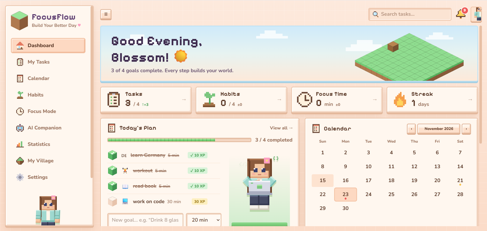

# FocusFlow — Build Your Better Day

Minecraft-style daily routine dashboard. React + TypeScript + Tailwind (client), Node + Express + TypeScript (server).
Personal project: built for you + one other person.

# Screenshots

<p align="center">
  
</p>

## Run it on your computer (development)

```bash
npm run install:all
cp server/.env.example server/.env     # then edit it (see below)
npm run dev                            # app: http://localhost:5173  (API on :4000)
```

The first time you open it you create an account. **Only 2 accounts can ever be created** (`MAX_USERS`).
The first account also inherits data from the old single-user version, if any.

## Run it as one process (what you host / share)

```bash
npm run install:all
npm run build          # builds the web app into client/dist
npm start              # server on :4000 serves the API *and* the web app
```

Open http://localhost:4000. Everything lives behind that one address.

## Sharing with one other person

Pick one — they all run the same `npm start`:

1. **Same Wi-Fi:** run it on your PC and give your friend `http://<your-PC-IP>:4000`. Works only while your PC is on.
2. **A tunnel to your PC** (e.g. Cloudflare Tunnel or Tailscale): gives a link that works from anywhere, still only while your PC is on.
3. **A cloud host** that can run Node and has a **persistent disk/volume**: set `DATA_DIR` to that disk.
   Hosts whose disk is wiped on restart will delete everyone's progress — avoid those, or keep backups.

If the app is reachable from the internet: set `INVITE_CODE` in `server/.env` (otherwise anyone who finds the link could take the 2nd account slot), and use HTTPS (hosts and tunnels give you that).

## Your data

Saved on the **server**, per account, in `server/data/users/<name>.json` (not in the browser). Clearing browser data or switching device
only logs you out — log in again and your tasks, XP and village are back.
**Back up `server/data/`** (just copy the folder). Passwords are stored hashed (scrypt), never in plain text.

## AI coach

Works in two modes (see `server/src/ai.ts`):

- **Offline coach (default):** rules written in code. No internet, key or cost.
- **Claude:** set `ANTHROPIC_API_KEY` in `server/.env`. Note: the Claude API is only available in countries on Anthropic's supported list — check https://www.anthropic.com/supported-countries before trying.

## Structure

```
client/src/components   Cube, Avatar (SVG character), Sprite, IsoScene (voxel village), Layout, AuthGate
client/src/pages        one file per sidebar section
client/src/lib/village.ts   the 25 buildable pieces
server/src              index.ts (routes), auth.ts, db.ts, ai.ts, xp.ts, quotes.ts
shared/types.ts         types used by both sides
```
